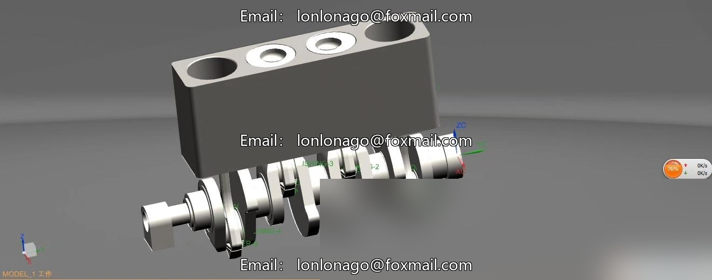
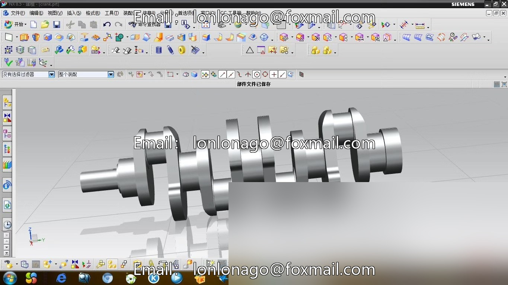
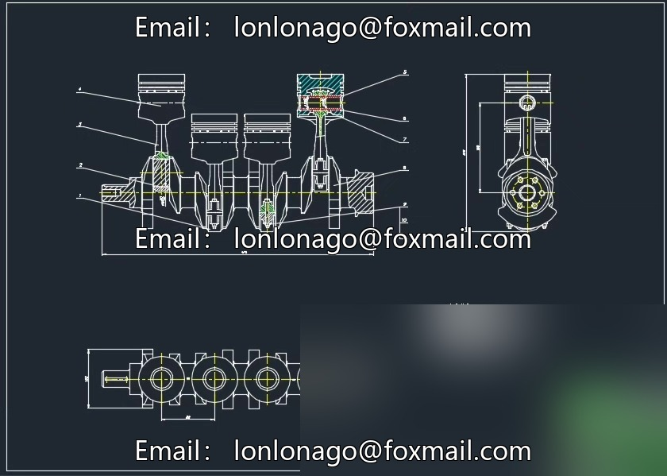
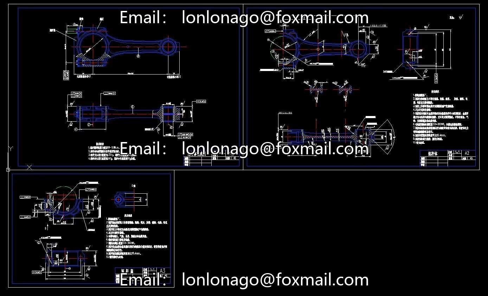

# A012 Crank and connecting rod mechanism drawing Crank and connecting rod mechanism design drawing Engine crank and connecting rod

## Body

A012 Crank Linkage Mechanism Diagram Crank Linkage Mechanism Design Diagram Engine Crank Linkage Mechanism Three-Dimensional Diagram Two-Dimensional Diagram and other

The diagram includes crank-linkage mechanism drawings, design drawings and engine crank-linkage related figures, with editable support for UG and Catia; the images show working modes and tool information.

<!-- AI_ENRICHED -->

## Images

## Payment

Here is a pay link on Stripe ( https://buy.stripe.com/3cs8yP7sY87d0vu9AB ). Please contact me lonlonago@foxmail.com after funding $89, and I will send you a complete data files , thank you!

